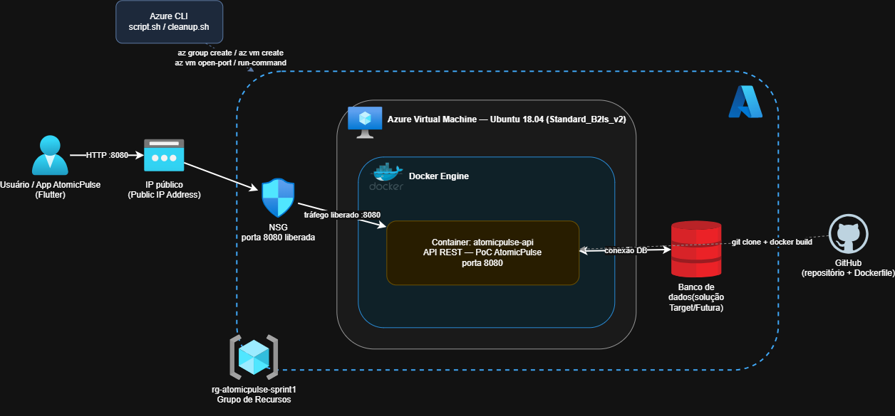

# AtomicPulse — Challenge 2026 | DevOps Tools & Cloud Computing (Sprint 1)

Challenge FIAP 2026 · 2º ano ADS (2TDSPA) · Empresa parceira: AMAZUL / CTMSP (Marinha do Brasil)

## Integrantes

| Nome | RM | Turma |
| :--- | :--- | :--- |
| **Alan Christopher Miranda** | 567033 | 2TDSPA |
| **Guilherme Santos Sena** | 568101 | 2TDSPA |
| **Igor Dantas da Silva** | 568337 | 2TDSPA |

---

## Sobre a solução
O **AtomicPulse** é um app mobile (Flutter) educativo sobre tecnologia nuclear, com quiz gamificado (3 níveis, ranking, salas por QR code) e um radar de notícias. Nesta Sprint 1, como prova de conceito de DevOps e Cloud, utilizamos uma API simples em Python/Flask, conteinerizada com Docker e executada em uma VM no Azure. A API Java do projeto será integrada nas próximas sprints.

---

## Arquitetura



---

## Estrutura do repositório

* `Dockerfile`        -> build da API em Python Flask / Gunicorn.
* `script.sh`         -> script Azure CLI para criação do RG, VM, liberação de porta e visualização do IP Público.
* `cleanup.sh`        -> script para deleção completa do Resource Group.
* `docs/`             -> contém a imagem do diagrama de arquitetura.
* `app.py` / `requirements.txt` -> arquivos de código-fonte da aplicação.

---

## Comandos Azure CLI utilizados

```bash
az login

az group create --name rg-atomicpulse-sprint1 --location southafricanorth

az vm create \
  --resource-group rg-atomicpulse-sprint1 \
  --name vm-atomicpulse-api \
  --image Canonical:UbuntuServer:18_04-lts-gen2:18.04.202401162 \
  --size Standard_B2ls_v2 \
  --admin-username azureuser \
  --generate-ssh-keys \
  --public-ip-sku Standard

az vm open-port --port 8080 --resource-group rg-atomicpulse-sprint1 --name vm-atomicpulse-api

az vm list-ip-addresses --resource-group rg-atomicpulse-sprint1 --name vm-atomicpulse-api --output table

az group delete --name rg-atomicpulse-sprint1 --yes --no-wait
```

---

## Instruções básicas para execução

**Pré-requisitos:** Azure CLI instalado, conta Azure autenticada (`az login`), Git e acesso SSH.

1. **Fazer login e provisionar a infraestrutura na nuvem:**
```bash
az login
bash script.sh
```

2. **Acessar a VM por SSH e executar a aplicação no Docker:**
*(Utilize o IP Público exibido no final do passo anterior)*
```bash
ssh azureuser@<IP-PUBLICO-DA-VM>

sudo apt-get update && sudo apt-get install -y docker.io
sudo systemctl start docker

git clone https://github.com/Igor-D1/Challenge-2-ano.git
cd "Challenge-2-ano/DevOps Tools & Cloud Computing"

sudo docker build -t atomicpulse-api .
sudo docker run -d -p 8080:8080 --name atomicpulse-app atomicpulse-api
```

3. **Acessar e validar a aplicação pelo navegador:**
```text
http://<IP-PUBLICO-DA-VM>:8080
```

4. **Ao terminar, apagar os recursos:**
```bash
bash cleanup.sh
```

---

## Pergunta Obrigatória

**Como Docker e Cloud Computing podem ser utilizados na solução proposta pelo grupo?**

O Docker empacota a API do AtomicPulse (código, dependências e configuração) em uma imagem única, que roda de forma idêntica no notebook de qualquer integrante, na VM do Azure ou em qualquer outro ambiente — acabando com o "na minha máquina funciona". Isso facilita a entrega contínua e a atualização das perguntas e funcionalidades.

A Cloud Computing (Microsoft Azure) permite disponibilizar essa API na internet para o app mobile e para o público das palestras da AMAZUL, que entra nas salas por QR code. Como a demanda é irregular (picos durante palestras e campanhas), a nuvem permite provisionar recursos sob demanda via Azure CLI, escalar quando necessário e remover tudo ao final, pagando apenas pelo que for usado. Nas próximas sprints a mesma imagem poderá receber banco de dados gerenciado e o radar de notícias (.NET).